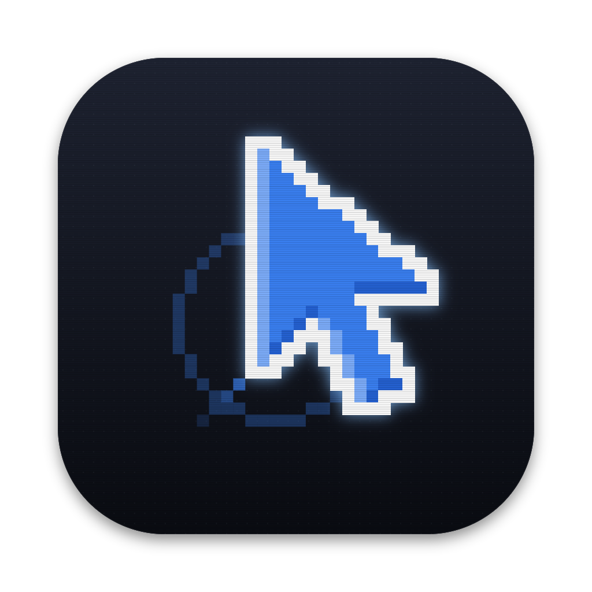

<p align="center"></p>

# Clinqy for Windows

The same Clinqy as on the Mac: press **Ctrl+Alt**, type or say what you want, and the small glowing companion
cursor goes and does it on screen. It clicks the taskbar, types into the address bar, ticks the checkboxes and fills
the form, asks you before anything consequential, remembers useful things about you, and can learn a task by
watching you do it once.

It's a native Windows app (Rust: UI Automation, SendInput, Windows OCR, WebView2), not a port of the Swift code, but
it shares everything that matters with the Mac app: the browser extension, the settings file, memory, history,
workflows, skills, the prompt, the `clinqy` command and the MCP server. A workflow or QA test recorded on a Mac
replays on Windows.

## Install

**Requirements:** Windows 10 (1903+) or 11, x64. WebView2 (built into Windows 11 and current Windows 10).

1. Download `Clinqy-windows-x64.zip` from the [latest release](https://github.com/Amrit-Nigam/clinqy/releases/latest),
   unzip it and double-click **`Install Clinqy.bat`**. No admin rights needed. It installs to
   `%LOCALAPPDATA%\Programs\Clinqy`, adds a Start menu shortcut, puts `clinqy` on your PATH
   and starts Clinqy.
2. Paste the setup prompt from the [main README](../README.md#setup-on-windows) (or the website) into your coding agent.
   It picks the AI you already have (Claude Code, then Codex, then agy, then Ollama), has Clinqy load its own browser
   extension, connects the agent and checks everything.

Without a coding agent, run `clinqy setup` in a new terminal: it does the same and ends with a "Needs you" list. Each step
also works alone:

```powershell
clinqy model              # the AI Clinqy uses (`clinqy model agy`, `claude`, `codex`, `ollama`…; `auto` is the default)
clinqy models             # the models it offers on this PC (`clinqy model codex gpt-6.1-terra` picks one)
clinqy extension install  # Clinqy loads its own extension into Chrome, Edge or Brave
clinqy connect all        # MCP for coding agents: all, or claude, codex, agy, cursor, gemini, windsurf
clinqy doctor
```

Everything is also in the Clinqy window: the gear on the command bar, or tray icon → **Dashboard…**. To uninstall,
double-click `Uninstall Clinqy.bat` in the install folder (`uninstall.ps1 -Purge` also deletes your settings and data).

## Using it

| | |
|---|---|
| **Tap Ctrl+Alt** | Open the command bar. Type, press Enter. |
| **Hold Ctrl+H** | Talk: it listens only while you hold it and sends when you let go (on-device Whisper, downloaded the first time). A quick tap still reaches the app in front. |
| **Ctrl+Alt while it works** | Add to the task or change the plan; **Pause** / **Resume** (holds before its next step) or **Stop** (at once). |
| **Click the tray icon while it works** | Stop. The tray menu also has Pause. `clinqy pause`, `clinqy resume` and `clinqy stop` work from a terminal. |
| **Esc** | Close the bar. |

The footer of the bar has the same tools as on the Mac: **Dry run** (it points at everything it would click and
type, without doing it), **Circle** (draw a loop around something on screen and ask about "this"), **Watch & learn**
(do a task once while it watches; it learns it as a skill), **Skills** and **History** (continue, run again, save
as a workflow).

Only the left Alt counts, so AltGr typing (Ctrl+Alt on many keyboards) never opens Clinqy. Another chord:
`HOTKEY=ctrl+win` (or `ctrl+shift`, `alt+win`) in the settings file.

## Background tasks

Say "in the background" in a request, or turn on Background on the bar, and Clinqy works in a separate headless Chrome or
Edge with its own profile, while you keep your mouse, keyboard, clipboard and windows. It never falls back to your desktop:
anything that can't be done hidden stops and asks, on a card in the top right (**Run in foreground**, **Keep in
background**, **Stop task**), and it tells you when it switches. A badge shows it's working; click it for the live view.
Tasks are saved in `%APPDATA%\Clinqy\tasks.json` and are never replayed after a restart. `clinqy run --background`, and
`background` on the MCP tool, do the same.

## The `clinqy` command and MCP

Same commands as on the Mac, for terminals and coding agents:

```powershell
clinqy run "open my latest invoice in Downloads and email it to Priya"
clinqy run --dry "turn on dark mode"          # show, don't do
clinqy qa tests\qa\checkout.md                # a QA test (Markdown), learned once then replayed
clinqy workflow "weekly report" week=32
clinqy look                                   # what's on screen, as text
clinqy setup                                  # everything at once, then what still needs you
clinqy doctor                                 # what's set up
clinqy tasks                                  # recent tasks and what happened to them
clinqy mcp                                    # stdio MCP server: clinqy_run, clinqy_look, clinqy_stats
```

`clinqy://` links work as on the Mac (registered by the app).

## Where things are

| | |
|---|---|
| Settings | `%USERPROFILE%\.config\clinqy\env` (same file and keys as the Mac; template: `env.example`) |
| History, memory, workflows, skills, profile | `%APPDATA%\Clinqy` |
| Logs | `%LOCALAPPDATA%\Clinqy\Logs\agent.log` and `runs.jsonl` |
| Voice models | `%LOCALAPPDATA%\Clinqy\voice` |

Everything stays on your PC except the model calls, which go only to the provider you chose. Clinqy's own windows
are kept out of screenshots and screen shares, so it never sees (or shows) itself.

## Build from source

Needs Rust (MSVC toolchain, `rustup default stable-x86_64-pc-windows-msvc`) and the Visual Studio C++ build tools.

```powershell
cd windows
cargo build                                    # debug: target\debug\ClinqyApp.exe and clinqy.exe
cargo test
powershell -ExecutionPolicy Bypass -File scripts\build-release.ps1   # dist\Clinqy-windows-x64.zip
```

A debug build finds the browser extension in the repo's `extension\` folder. To take screenshots *of* Clinqy (for
docs), start it with `CLINQY_CAPTURABLE=1`.

## How it's built

```
windows/
  crates/clinqy-core      the agent: models, prompt, the loop, memory, history, workflows, browser bridge.
                          No OS APIs; talks to the OS through the Platform and Buddy traits.
  crates/clinqy-windows   the Windows layer: UI Automation, input, screen capture, OCR, clipboard, hotkey,
                          the companion cursor, the status island, Circle.
  crates/clinqy-app       ClinqyApp.exe (tray, command bar, result card, voice, Watch & learn) and clinqy.exe
                          (CLI, MCP), talking over a per-user named pipe.
  scripts/                build-release, install, uninstall.
```

The command bar and result card are WebView2 pages styled with the Mac app's exact tokens (`ui/web/shared.css`); the
companion cursor, status island and Circle overlay are drawn natively (tiny-skia on layered windows) so they can be
click-through and never take focus.
